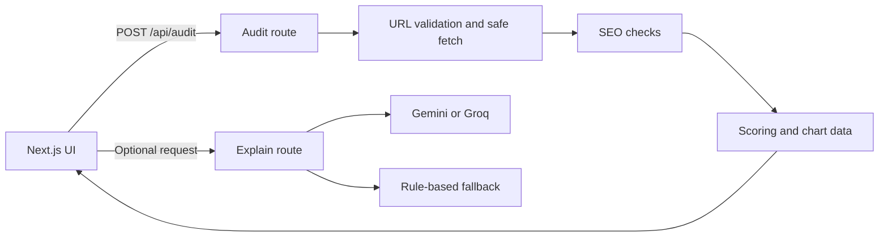

# SiteScope — Website SEO Audit

SiteScope is a free, deployable SEO audit app. Enter a public website address to get a score, practical recommendations, and an explanation of what to improve.

## License

This project is licensed under the ISC License. See [LICENSE](./LICENSE).

## Features

- Technical, on-page, performance, and accessibility checks
- Weighted 0–100 scores and clear recommendations
- Six dashboard charts, JSON export, and print-to-PDF support
- A bundled demo audit that works without API keys or network access
- Optional AI explanations with a rule-based fallback
- Optional PageSpeed Insights data
- Server-side URL fetching with SSRF protections and rate limits

## Screenshots

_Add screenshots of the landing page and results dashboard here._

## Architecture



## Run locally

```bash
npm install
npm run dev
```

Run the checks and production build with `npm test`, `npm run lint`, and `npm run build`. Open `/results?demo=1` to preview the bundled dashboard.

Copy `.env.example` to `.env.local` and add optional provider keys. The app is designed to work without any key.

## Deploy to Vercel Hobby

1. Push this repository to GitHub and import it in Vercel.
2. Keep the project on the free Hobby plan.
3. Add optional environment variables from `.env.example` in project settings.
4. Deploy and use the provided `*.vercel.app` URL.

Gemini and Groq keys are optional. A PageSpeed Insights key is optional as well. Set `SITE_URL` to the deployed base URL so canonical metadata, breadcrumb URLs, `robots.txt`, and sitemap links use the right domain. `NEXT_PUBLIC_SITE_URL` remains supported as a fallback for existing deployments. Set the variable in the deployment environment before building. Never expose provider keys in client-side environment variables.

## Limitations

- Audits sample at most 30 links to keep requests fast.
- Client-rendered pages are not executed, so single-page apps may appear mostly empty.
- Lightweight performance checks are indicators, not Core Web Vitals. PageSpeed Insights can provide Lighthouse data when configured.
- Some websites block automated requests; a 403 or 429 response is reported as such.
- Serverless execution limits constrain how much work a single audit can perform.
- The default in-memory rate limiter is per process and does not share state across serverless instances. Upstash Redis is the upgrade path for shared limits.

## Safety

Only audit sites you own or have permission to test.
